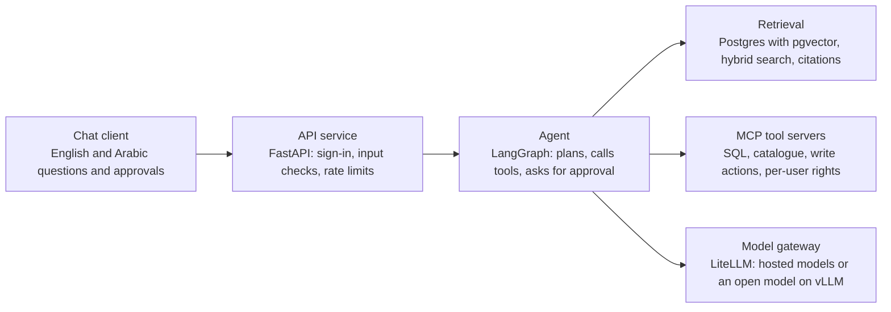

# AI Engineer Study Plan

A 28-week plan, at about 4 hours a week, that prepares a software engineer to work as an AI engineer who builds production agents. The plan is built around one project that grows in every phase, and this repository holds the plan and the project.

**Contents**

- [About the plan](#about-the-plan)
- [Roadmap](#roadmap)
- [Phase-by-phase plan](#phase-by-phase-plan)
  - [Phase 1: The Claude API and a hand-written agent loop (weeks 1 to 3)](#phase-1-the-claude-api-and-a-hand-written-agent-loop-weeks-1-to-3)
  - [Phase 2: Retrieval (weeks 4 to 7)](#phase-2-retrieval-weeks-4-to-7)
  - [Phase 3: Evaluation and tracing (weeks 8 to 11)](#phase-3-evaluation-and-tracing-weeks-8-to-11)
  - [Phase 4: Agents with LangChain, LangGraph and MCP (weeks 12 to 17)](#phase-4-agents-with-langchain-langgraph-and-mcp-weeks-12-to-17)
  - [Phase 5: Guardrails and governance (weeks 18 to 20)](#phase-5-guardrails-and-governance-weeks-18-to-20)
  - [Phase 6: The model gateway and self-hosted models (weeks 21 to 25)](#phase-6-the-model-gateway-and-self-hosted-models-weeks-21-to-25)
  - [Phase 7: Packaging (weeks 26 to 28)](#phase-7-packaging-weeks-26-to-28)
- [Study resources](#study-resources)
- [Capstone project](#capstone-project)
- [Turning the work into a job](#turning-the-work-into-a-job)

## About the plan

- **Who it is for:** a software engineer who wants to move into AI engineering. The plan expects you to know Python, SQL, FastAPI, Docker and one cloud platform, and it does not teach them.
- **What the plan closes:** a production agent with evaluation, retrieval, LangGraph, guardrails, a model gateway and a self-hosted model.
- **What the plan leaves out:** Kubernetes, cloud services such as AWS, Azure and Google Cloud, and AI regulation. Employers ask for them, but this plan does not teach them. Everything runs on your machine in Docker, except the Claude and OpenAI APIs and the GPU that you rent in Phase 6.
- **One project, not seven tutorials.** Each phase adds a layer to the same system, so the end result is one deep portfolio piece.
- **Tests before agents.** Evaluation comes in Phase 3, before the agent work, so everything after it is built against a score.
- **Weekly rhythm:** about 1 hour of reading and 3 hours of building. Each source teaches one topic, so no reading repeats another.

## Roadmap

| Phase | Weeks | What you build | Exit test |
| --- | --- | --- | --- |
| 1. Claude API | 1 to 3 | Tool calling, typed output, caching | Agent loop by hand, cost logged per call |
| 2. Retrieval | 4 to 7 | Parsing, embeddings, search, citations | Retrieval recall measured, Arabic too |
| 3. Evaluation | 8 to 11 | Test sets, graders, tracing, CI gate | CI blocks a drop in score on every change |
| 4. Agents | 12 to 17 | Memory, planning, LangGraph, MCP | Multi-step tasks pass tests on the result and the path |
| 5. Guardrails | 18 to 20 | Injection tests, permissions, audit | Attack suite pass rate reported |
| 6. Open models | 21 to 25 | Gateway, vLLM, LoRA fine-tune | Hosted and open models compared on the same test set |
| 7. Packaging | 26 to 28 | Write-up, CV, system design practice | Public repository and a rewritten CV |

After week 28, the checklist in the [week 28 exit test](#week-28-system-design-practice) is complete. Start conversations with employers after Phase 5.

Evaluation sits third, so the agent, guardrail and deployment phases are all built against a test score.

## Phase-by-phase plan

Each phase is a list of weeks, and each week is a list of steps: read, build, then check. Do the steps in order. In a normal week the reading takes about 1 hour and the building about 3 hours. When a check passes, write its numbers in the repository. If a check fails, fix it before you start the next week. Each phase ends with its exit test.

### Phase 1: The Claude API and a hand-written agent loop (weeks 1 to 3)

**Goal:** a small API service that answers questions about a dataset catalogue, with a model loop that you wrote yourself.

#### Week 1: The first request

1. Read: Claude [Get started](https://platform.claude.com/docs/en/get-started), [Using the Messages API](https://platform.claude.com/docs/en/build-with-claude/working-with-messages) and [Streaming messages](https://platform.claude.com/docs/en/build-with-claude/streaming).
2. Build: create the repository with a FastAPI service and a Postgres database, both in Docker Compose. Load the metadata of 50 public datasets (name, description, owner, columns, update date) from an open-data portal.
3. Build: in the Claude Console, buy $5 of API credit, keep auto-reload off, and create an API key. Use Claude Haiku 5.5 for all of Phase 1. It supports the tools, structured outputs, prompt caching and streaming that this phase uses. On the [price page](https://platform.claude.com/docs/en/about-claude/pricing) in November 2026, it costs $0.10 per million input tokens and $0.50 per million output tokens. Keep its default effort, medium. The [effort docs](https://platform.claude.com/docs/en/build-with-claude/effort) say that at low effort, in long agent prompts, the model is more likely to skip a search or stop early. My estimate for the whole phase is $1 to $3.
4. Build: add an /ask endpoint that sends the question to Claude and streams the answer back as server-sent events. Log the model, the input and output tokens, the cost and the latency of each request.
5. Build: send every Claude call through one client function with a response cache. The function makes a hash of the full request body, saves each response in a file under that hash, and replays the saved response when the same request comes again. A flag turns the cache off. While you debug code that does not change the request, the cache removes the repeat calls, and each replayed answer is a real Claude response.
6. Build: write 30 test questions. For each question, write the dataset IDs that a correct answer must name. Mark 5 of them as the quick set for daily work.
7. Check: one command sends a question and prints the answer, the tokens, the cost and the latency, and the stream works with curl. When you send the same question again, the response cache answers it and no API call is made.

#### Week 2: Tool calling and the model loop

1. Read: Claude [How tool use works](https://platform.claude.com/docs/en/agents-and-tools/tool-use/how-tool-use-works) and [Tutorial: Build a tool-using agent](https://platform.claude.com/docs/en/agents-and-tools/tool-use/build-a-tool-using-agent).
2. Build: write three tools: search\_datasets, get\_dataset\_schema and get\_dataset\_stats. Each tool reads Postgres and returns JSON.
3. Build: write the loop by hand, with no framework. When the model asks for a tool, run it, add the result to the messages and send again. Stop at a final answer or after 8 turns. When a tool fails, send the error back to the model as the tool result.
4. Check: the questions that need a tool get correct answers, and a broken tool does not stop the loop.

#### Week 3: Structured output, caching and the test runner

1. Read: Claude [Structured outputs](https://platform.claude.com/docs/en/build-with-claude/structured-outputs), [Prompt caching](https://platform.claude.com/docs/en/build-with-claude/prompt-caching) and [Prompting best practices](https://platform.claude.com/docs/en/build-with-claude/prompt-engineering/claude-prompting-best-practices).
2. Build: define the answer as a Pydantic model: the answer text, the dataset IDs used and the tools called. Fill it with structured output, and validate every response.
3. Build: put the system prompt and the tool definitions at the start of each request, and turn on prompt caching. On Haiku 5.5, the cached part must be at least 512 tokens, or the request does not cache. Read `cache_read_input_tokens` in the usage of each response, and measure the cost before and after. Prompt caching is different from the response cache of week 1. The model still runs and writes a new answer, and only the cached input costs less. On Haiku 5.5, a cache read costs $0.01 per million tokens instead of $0.10, and a cache write costs $0.125.
4. Build: write a test runner. One command runs the quick set or all 30 questions and writes pass or fail, tokens, cost and latency for each question. A question passes when the answer names the expected dataset IDs. While you build, use the quick set with the response cache on. For the exit test and for the checks in later phases, run all 30 with the cache off, because a replayed answer is one old sample and the answers change from run to run.
5. Check: the exit test below.

**Exit test:** the 30 questions run from one command with the response cache off, every request logs tokens, cost and latency, and the logs show cache reads from prompt caching.

### Phase 2: Retrieval (weeks 4 to 7)

**Goal:** a retrieval tool over documents in English and Arabic, with recall that you measured.

#### Week 4: Parse and chunk the documents

1. Read: Huyen, chapter 6: RAG, RAG Architecture and Retrieval Algorithms (pages 253 to 268).
2. Build: collect about 100 public documents in English and Arabic that describe the datasets in your catalogue, for example data dictionaries and method notes.
3. Build: parse them with [PyMuPDF](https://pymupdf.readthedocs.io/en/latest/). Read the output of 5 Arabic PDFs. If the words are out of order, try [Docling](https://docling-project.github.io/docling/) on the same files and keep the better parser.
4. Build: normalise the Arabic text (for example, remove diacritics and tatweel). Split the documents into chunks of a fixed size with some overlap. Store each chunk with its document ID, language and page.
5. Check: the parsed Arabic text reads in the correct order.

#### Week 5: Embeddings and vector search

1. Read: the [pgvector README](https://github.com/pgvector/pgvector): Getting Started, Storing, Querying, HNSW and Filtering. The [BGE-M3](https://huggingface.co/BAAI/bge-m3) model card.
2. Build: embed the chunks with a multilingual model such as BGE-M3, store the vectors in pgvector and add an HNSW index.
3. Build: write 50 retrieval questions, 25 in Arabic and 25 in English, each with the IDs of the chunks that hold the answer. Let a model write a first draft, then correct it by hand.
4. Check: you know the recall in the top five results for each language.

#### Week 6: Hybrid search and re-ranking

1. Read: Huyen, chapter 6: Retrieval Optimization (pages 268 to 273). The pgvector README: Hybrid Search.
2. Build: add Postgres full-text search on the chunks. For Arabic, list the text search configurations of your Postgres (\\dF) and test one. [Controlling Text Search](https://www.postgresql.org/docs/current/textsearch-controls.html) explains the settings.
3. Build: merge the keyword results and the vector results with reciprocal rank fusion. Then re-rank the top 20 with a cross-encoder such as [bge-reranker-v2-m3](https://huggingface.co/BAAI/bge-reranker-v2-m3).
4. Check: a table of recall in the top five for vector search, hybrid search, and hybrid search with re-ranking, for each language.

#### Week 7: Retrieval as a tool, with citations

1. Read: Huyen, chapter 6: RAG Beyond Texts (pages 273 to 275), for retrieval over tables.
2. Build: add the retrieval as a tool of the Phase 1 loop. Each answer cites the document title, the page and the chunk ID of each source.
3. Build: when an answer cites a chunk ID that the tool did not return, reject the answer and ask the model again.
4. Check: the exit test below.

**Exit test:** 50 retrieval questions, with recall in the top five results measured before and after hybrid search and re-ranking, reported separately for Arabic and English.

### Phase 3: Evaluation and tracing (weeks 8 to 11)

**Goal:** every step is traced, the test set has more than 100 cases, the grader agrees with your labels, and CI blocks a worse change.

#### Week 8: Tracing

1. Read: Langfuse [Get Started with LLM Tracing](https://langfuse.com/docs/observability/get-started). In the [AI Evals FAQ](https://hamel.dev/blog/posts/evals-faq/): "What is a trace?" and "What's a minimum viable evaluation setup?".
2. Build: run Langfuse on your machine with [Docker Compose](https://langfuse.com/self-hosting/deployment/docker-compose).
3. Build: trace every model call, tool call and retrieval step, with tokens, cost and latency on each span.
4. Check: one request shows in Langfuse as one trace, with every step inside it.

#### Week 9: Error analysis

1. Read: in the FAQ: "Why is error analysis so important in AI evals, and how is it performed?", "How many examples do I need for an eval?" and "What is the best approach for generating synthetic data?".
2. Build: generate about 100 different questions in English and Arabic, correct them by hand, and run them through the system.
3. Build: read 30 traces yourself. Write a short note on each failure (open coding). Then put the notes into failure categories and count them (axial coding).
4. Build: add the failing cases, with expected results, to a Langfuse dataset.
5. Check: a table of failure categories with their counts, and a test set of more than 100 cases.

#### Week 10: The grader model

1. Read: Huyen, chapter 3: Limitations of AI as a Judge and What Models Can Act as Judges? (pages 141 to 148). In the FAQ: "Why do you recommend binary (pass/fail) evaluations instead of 1-5 ratings (Likert scales)?", "How do I know if I can trust my automated eval?" and "What should I do when I can't get my LLM judge to agree with human reviewers?".
2. Build: for the largest failure category, write a pass or fail rubric with examples, and a grader prompt for it.
3. Build: label 50 outputs yourself, then run the grader on the same 50. Measure its true positive rate and true negative rate against your labels. Change the rubric until you accept both rates.
4. Check: you can state the agreement rates of the grader with your labels.

#### Week 11: Evaluation in CI

1. Read: Huyen, chapter 4: Model Selection (pages 179 to 200). In the FAQ: "How are evaluations used differently in CI/CD vs. monitoring production?".
2. Build: write a pytest suite that runs a fixed subset of the test set with the code checks and the grader.
3. Build: add a GitHub Actions job that runs the suite on each pull request and fails when a score falls below its threshold.
4. Build: open a pull request with a deliberately bad prompt change.
5. Check: the exit test below.

**Exit test:** a deliberately bad prompt change is blocked by CI, and you can state the grader's agreement rate with your labels.

### Phase 4: Agents with LangChain, LangGraph and MCP (weeks 12 to 17)

**Goal:** the agent runs on LangGraph on two providers, with memory, a planner, approval for write actions and MCP tool servers.

#### Week 12: Memory by hand

1. Read: Huyen, chapter 6: Memory (pages 300 to 305). [Effective context engineering for AI agents](https://www.anthropic.com/engineering/effective-context-engineering-for-ai-agents) for compaction and note-taking.
2. Build: compaction. When the conversation gets near the context limit, summarise it and start a new context with the summary.
3. Build: long-term memory. Let the agent write facts to a long-term store, and find them again with the pgvector search from Phase 2.
4. Check: a long conversation continues after compaction, and a fact saved in one session is used in the next session.

#### Week 13: Planning by hand

1. Read: Huyen, chapter 6: Agent Overview, Tools and Planning (pages 275 to 298).
2. Build: a planner. The model writes a plan, the loop runs each step, and the model changes the plan when a step fails.
3. Check: a task with a failing step finishes with a changed plan.

#### Week 14: Move the loop to LangChain and LangGraph

1. Read: [Building effective agents](https://www.anthropic.com/engineering/building-effective-agents) for workflow patterns and for when plain code beats a model call. LangChain [Agents](https://docs.langchain.com/oss/python/langchain/agents) and [Models](https://docs.langchain.com/oss/python/langchain/models). [LangGraph overview](https://docs.langchain.com/oss/python/langgraph/overview) and [Graph API overview](https://docs.langchain.com/oss/python/langgraph/graph-api).
2. Build: rebuild the loop, with its memory and planner, as a LangGraph graph. Keep the same tools. Use the LangChain model integrations, so that the same graph runs on Claude and on OpenAI.
3. Build: where a step always does the same thing (for example, formatting the citations), replace the model call with plain code.
4. Build: run the test set on both providers. Compare the scores and the amount of code with the hand-written loop, and keep the comparison for interviews.
5. Check: the LangGraph version scores at least as well as the hand-written loop.

#### Week 15: Persistence, approval and the audit log

1. Read: LangGraph [Memory](https://docs.langchain.com/oss/python/langgraph/add-memory) (the "Use in production" parts) and [Interrupts](https://docs.langchain.com/oss/python/langgraph/interrupts).
2. Build: store each conversation with the Postgres checkpointer (PostgresSaver), and replace your long-term store with the LangGraph Postgres store (PostgresStore).
3. Build: add a write action, register\_dataset. Pause the graph with an interrupt before the action runs, and continue only after a person approves.
4. Build: write an audit log of every tool call: the user, the arguments, the result and the approval.
5. Check: after a restart of the service, a conversation continues from its last step, register\_dataset does not run without approval, and every tool call is in the audit log.

#### Week 16: MCP tool servers

1. Read: MCP [Architecture overview](https://modelcontextprotocol.io/docs/learn/architecture) and [Build an MCP server](https://modelcontextprotocol.io/docs/develop/build-server). LangChain [Model Context Protocol (MCP)](https://docs.langchain.com/oss/python/langchain/mcp).
2. Build: move the tools to two MCP servers: one for SQL queries, and one for catalogue lookup and register\_dataset.
3. Build: make the SQL server safe: a read-only database role, a list of allowed tables, a row limit and a query timeout.
4. Build: connect the agent to the servers with the LangChain MCP adapters.
5. Check: the SQL server refuses a statement that writes data, and the test set still passes.

#### Week 17: Agent evaluation

1. Read: Huyen, chapter 6: Agent Failure Modes and Evaluation (pages 298 to 300). In the FAQ: "How do I evaluate agentic workflows?".
2. Build: write 30 multi-step tasks. For each task, write the expected final result and the expected tool calls.
3. Build: score each task on the final result and on the path that the agent took. Add the tasks to the CI suite.
4. Check: the exit test below.

**Exit test:** 30 multi-step tasks are scored on the final result and on the path taken, and the write action cannot run without approval.

### Phase 5: Guardrails and governance (weeks 18 to 20)

**Goal:** an attack suite that runs in CI, and defences in the design of the agent that raise its pass rate.

#### Week 18: The attack suite

1. Read: Huyen, chapter 5: Defensive Prompt Engineering (pages 235 to 251). Willison, [The lethal trifecta for AI agents](https://simonwillison.net/2025/Jun/16/the-lethal-trifecta/).
2. Build: put poisoned documents in the corpus, in English and Arabic, with instructions hidden in the text.
3. Build: write 30 attack cases: direct injection, poisoned documents, instructions inside tool results, and attempts to send data out (for example, through a link or a tool call).
4. Build: run the cases with pytest in CI, and record the pass rate for each kind of attack.
5. Check: the suite runs in CI and reports its first pass rate.

#### Week 19: Sign-in and per-user permissions

1. Read: MCP [Understanding Authorization in MCP](https://modelcontextprotocol.io/docs/tutorials/security/authorization). Postgres [Row Security Policies](https://www.postgresql.org/docs/current/ddl-rowsecurity.html).
2. Build: run Keycloak in Docker as the authorization server, and add OAuth authorization to the MCP servers, as the tutorial shows.
3. Build: enforce the permissions of each user in the servers before retrieval and SQL run, for example with row security policies.
4. Check: a call without a valid token is refused, and a user cannot get rows or documents outside their permissions, also when an attack asks for them.

#### Week 20: A design pattern and input and output checks

1. Read: Willison, [Design Patterns for Securing LLM Agents against Prompt Injections](https://simonwillison.net/2025/Jun/13/prompt-injection-design-patterns/). NeMo Guardrails [PII detection](https://docs.nvidia.com/nemo/guardrails/configure-guardrails/guardrail-catalog/pii-detection) and [Jailbreak protection](https://docs.nvidia.com/nemo/guardrails/configure-guardrails/guardrail-catalog/jailbreak-protection).
2. Build: apply one design pattern. For example, after the agent reads untrusted content, it cannot call a write tool without approval.
3. Build: run the NeMo Guardrails server in Docker, and add input and output checks: its jailbreak checks, and its PII detection, which uses Presidio. Test them on Arabic text and write down what they miss.
4. Build: run the attack suite again, and compare the pass rate for each kind of attack with week 18. Write down why each remaining failure gets past your defences.
5. Check: the exit test below.

**Exit test:** the attack pass rate is reported and runs in CI, and for each kind of attack it is higher than in week 18.

### Phase 6: The model gateway and self-hosted models (weeks 21 to 25)

**Goal:** every model call goes through a gateway, and an open model runs on a rented GPU, also quantized and fine-tuned, measured against the hosted model on the same test set. Rent the GPU by the hour on RunPod. A RunPod pod runs any Docker image that you name, so vLLM runs there in the same image as on your machine. A 48 GB GPU, such as an A40 or an RTX A6000, has enough memory to serve an 8B model, for example Qwen3-8B, and to train a LoRA adapter for it. On the RunPod price page in November 2026, these two GPUs cost $0.59 and $0.69 an hour. Stop the pod at the end of each session, so you pay only for the hours you use. The gateway and the rest of the system stay on your Mac.

#### Week 21: The model gateway

1. Read: Huyen, chapter 10: Step 3. Add Model Router and Gateway, and Step 4. Reduce Latency with Caches (pages 456 to 463). LiteLLM [AI Gateway](https://docs.litellm.ai/docs/simple_proxy) and [Fallbacks](https://docs.litellm.ai/docs/proxy/reliability).
2. Build: run the LiteLLM proxy with Docker Compose, and send every model call through it.
3. Build: add a fallback from Claude to OpenAI, and a budget for each user ([Budgets, Rate Limits](https://docs.litellm.ai/docs/proxy/users) shows how).
4. Check: when you remove the Claude key, requests fall back to OpenAI, and the test suite passes.

#### Week 22: An open model on vLLM

1. Read: Huyen, chapter 9, the first half (pages 405 to 426). vLLM [Using Docker](https://docs.vllm.ai/en/latest/deployment/docker/). RunPod [Pods overview](https://docs.runpod.io/pods/overview) and [Expose ports](https://docs.runpod.io/pods/configuration/expose-ports).
2. Build: rent a pod with a 48 GB GPU on RunPod, run the vllm/vllm-openai image on it, and serve the open model. Start vLLM with an API key, because the pod's port is open to the internet.
3. Build: add the model to the gateway on your Mac. Run the test set on it, and measure quality and latency. Then send 1, 8 and 32 requests at the same time, and measure the tokens per second at each load.
4. Check: the test set runs on the open model through the gateway.

#### Week 23: A quantized model on the same GPU

1. Read: Huyen, chapter 9, the second half (pages 426 to 447), and chapter 7: Quantization (pages 328 to 332).
2. Build: serve the 4-bit AWQ version of the same model ([Qwen3-8B-AWQ](https://huggingface.co/Qwen/Qwen3-8B-AWQ)) with vLLM on the same GPU.
3. Build: add the quantized model to the gateway, and measure it again at the same loads. Write down how much GPU memory each model uses.
4. Optional: serve the same model on your Mac at no cost. Install llama.cpp with Homebrew ([Install](https://github.com/ggml-org/llama.cpp/blob/master/docs/install.md)), and serve the 4-bit file of the same model ([Qwen3-8B-GGUF](https://huggingface.co/Qwen/Qwen3-8B-GGUF)) with `llama serve -hf Qwen/Qwen3-8B-GGUF:Q4_K_M`. Run it directly on macOS, not in Docker. On macOS, llama.cpp uses the Apple GPU through Metal, and Docker on a Mac cannot use the GPU. Add the model to the gateway, and add its quality and latency to the table.
5. Check: a table that compares the hosted, the open and the quantized models on the same test set.

#### Week 24: Training data for a LoRA fine-tune

1. Read: Huyen, chapter 7: When to Finetune and Parameter-Efficient Finetuning (pages 311 to 319 and 333 to 347).
2. Build: choose one Arabic task where the open model fails in your test set, for example answers in Arabic about the catalogue.
3. Build: make a training set of a few hundred examples from your traces and labels. Remove duplicates, and keep the test cases out of the training set.
4. Check: no case in the training set is also in the test set.

#### Week 25: Train and serve the adapter

1. Read: TRL [SFT Trainer](https://huggingface.co/docs/trl/sft_trainer), the part "Train adapters with PEFT". vLLM [LoRA Adapters](https://docs.vllm.ai/en/latest/features/lora/), the part "Serving LoRA Adapters".
2. Build: run one LoRA fine-tune of the open model with TRL on the rented GPU.
3. Build: serve the adapter with vLLM beside the base model, and score it with the test set. Copy the adapter to your Mac, then delete the pod.
4. Check: the exit test below.

**Exit test:** one table compares the hosted, open, quantized and fine-tuned models on the same test set, for quality, latency and cost per 1,000 requests. For the open models, calculate the cost from the GPU's hourly price and the requests per hour that you measured.

### Phase 7: Packaging (weeks 26 to 28)

**Goal:** the work is written up, public and ready for interviews.

#### Week 26: Feedback, monitoring and the architecture document

1. Read: Huyen, chapter 10: Step 5. Add Agent Patterns, Monitoring and Observability, AI Pipeline Orchestration, and User Feedback (pages 463 to 492).
2. Build: add a feedback control to each answer (good or bad, with an optional comment), and store the feedback in Langfuse with the trace.
3. Build: add a dashboard of 95th-percentile latency, cost per request and the evaluation scores over time.
4. Write: an architecture document that explains each choice, including where plain code replaced a model call.
5. Check: every number in the document comes from your own runs.

#### Week 27: The public write-up and the CV

1. Write: a public write-up with the repository and the numbers from the capstone list.
2. Write: a new CV that starts with the target title and the numbers of the project.
3. Check: the repository is public, and the CV quotes its numbers.

#### Week 28: System design practice

1. Practise: work through four agent designs aloud, about 45 minutes each: a bank knowledge assistant, an ERP process agent, an analytics agent and an on-call agent.
2. Check: the exit test below.

**Exit test:** each item below is true of the capstone, and you can show it. Kubernetes and a second cloud are not on the list, because this plan leaves them out.

- [ ] An agent with at least three tools completes multi-step tasks for real users.
- [ ] Answers drawn from documents cite their sources, and retrieval quality is measured.
- [ ] A test set of 100 or more cases exists, including cases in Arabic.
- [ ] A grader model scores outputs against a written rubric, and its agreement with your own labels is measured.
- [ ] A pipeline blocks any change that lowers the test scores.
- [ ] Every request is traced, with cost and latency reported per request.
- [ ] A tool server enforces each user's permissions before any data reaches the model.
- [ ] Write actions cannot run without human approval, and every action is logged.
- [ ] A prompt-injection test suite runs on every change, and its pass rate is reported.
- [ ] The same system runs on a self-hosted open model, compared with the hosted one on quality, latency and cost.
- [ ] An architecture document explains each choice, including where plain code replaced a model call.
- [ ] The code and results are public, and your CV quotes the numbers.

## Study resources

Seven resources cover the plan. One is Chip Huyen's book, which you can read free for now through library access. The other six are free written sources. They were chosen by quality first, then by the fewest resources, then by cost, then by reading over video. When two sources explain the same topic well, the plan keeps only one. Where a rule would have lowered quality, the rule gave way.

| Resource | Cost | Format | Phases | What it covers |
| --- | --- | --- | --- | --- |
| [Claude API documentation](https://platform.claude.com/docs/en/get-started) | Free | Docs | 1 | The Messages API, tool use and the hand-written tool loop, structured output, prompt caching and prompting |
| [AI Engineering](https://www.oreilly.com/library/view/ai-engineering/9781098166298/), Chip Huyen (O'Reilly, 2025) | Free through library access for now. $79.99 list to buy. | Book | 2, 3, 4, 5, 6, 7 | Ch. 6: retrieval, RAG over tables, agents, planning and memory (Phases 2 and 4). Ch. 3 and 4: the limits of AI judges, and model selection (Phase 3). Ch. 5, Defensive Prompt Engineering: the kinds of prompt attack (Phase 5). Ch. 7 and 9: fine-tuning, quantization and inference (Phase 6). Ch. 10: the model gateway, monitoring and user feedback (Phases 6 and 7). |
| [AI Evals FAQ](https://hamel.dev/blog/posts/evals-faq/), Husain and Shankar | Free | Article | 3, 4 | Error analysis, test sets, pass or fail graders and their agreement with your labels, evaluation in CI, and agent evaluation |
| Anthropic: [Building effective agents](https://www.anthropic.com/engineering/building-effective-agents) and [Effective context engineering for AI agents](https://www.anthropic.com/engineering/effective-context-engineering-for-ai-agents) | Free | Articles | 4 | Workflow patterns, and when plain code beats a model call. Compaction and note-taking when the context is full. |
| LangChain and LangGraph documentation (docs.langchain.com) | Free | Docs | 4 | LangChain agents and model integrations. LangGraph graphs, memory, persistence and interrupts. |
| Model Context Protocol documentation (modelcontextprotocol.io) | Free | Docs | 4, 5 | The architecture, how to build a server, and authorization |
| Simon Willison: [The lethal trifecta for AI agents](https://simonwillison.net/2025/Jun/16/the-lethal-trifecta/) and [Design Patterns for Securing LLM Agents against Prompt Injections](https://simonwillison.net/2025/Jun/13/prompt-injection-design-patterns/) | Free | Articles | 5 | Why an agent with private data, untrusted content and a way to send data out can leak data. Six design patterns that limit prompt injection in agents, for example plan-then-execute and dual LLM. |

Phase 1 uses the Claude documentation. Phase 2 uses Huyen's chapter 6. Phase 3 uses the evals FAQ, plus two short parts of Huyen's chapters 3 and 4. Phase 4 uses the LangChain, LangGraph and MCP documentation, Huyen's chapter 6 for agents, planning and memory, and the two Anthropic essays. Phase 5 uses Huyen's chapter 5 for the kinds of attack, Willison's two posts for defences built into the agent, and the MCP authorization tutorial. Phases 6 and 7 use Huyen's chapters 7, 9 and 10.

Beyond these seven, open a tool's documentation only when a build step uses it. The steps link to each page: PyMuPDF, Docling, pgvector, BGE-M3, the BGE re-ranker and Postgres text search in Phase 2, Langfuse in Phase 3, Postgres row security, Keycloak and NeMo Guardrails in Phase 5, and LiteLLM, RunPod, vLLM, TRL and llama.cpp in Phase 6. These pages are for reference, not for study.

**Where quality overrode the rules.** Huyen's book is the only resource that costs money to buy. It stays because no free written source matches it on retrieval, fine-tuning and serving trade-offs. You can read it free for now through the [Florham Park Public Library's O'Reilly access](https://florhamparklib.org/databases/oreilly-for-public-libraries/), which needs no library card. Click its button in the same tab. If that access ends, Phases 4 and 7 can use the author's free posts [Agents](https://huyenchip.com/2025/01/07/agents.html) and [Building A Generative AI Platform](https://huyenchip.com/2024/07/25/genai-platform.html) with little loss, and Phase 5 still has Willison's posts. Phases 2 and 6 then need a bought copy.

**Dropped, and why**

- Claude Platform 101 (Anthropic Academy): free, but it teaches the same Phase 1 topics as the Claude documentation, with less depth. One source is enough.
- Anthropic Academy, Building with the Claude API: free, but it is for developers new to LLMs. Its lesson list has nothing on Tool Runner, Skills, Managed Agents, context editing or the memory tool. The Claude documentation covers Phase 1 with current features.
- OpenAI and Gemini API documentation: they teach the same concepts as the Claude documentation. The agent runs on OpenAI through LangChain in Phase 4 and through the gateway in Phase 6, so no separate reading is necessary.
- AI Evals email course: by the same authors as the FAQ, with the same method. The FAQ covers each Phase 3 step.
- Huyen, chapters 3 and 4, except two parts: the FAQ teaches the method that the Phase 3 builds use (error analysis, pass or fail graders, agreement rates) in a more practical form. The plan keeps the two parts that the FAQ does not cover: the limits of AI judges (week 10) and model selection (week 11).
- Huyen, chapter 8: Phase 6 trains one small adapter, and its build step gives the two rules that this needs: remove duplicates, and keep the test cases out of the training set.
- OWASP Top 10 for LLM Applications and for Agentic Applications: Huyen's chapter 5 explains the kinds of prompt attack, and Willison's posts explain the defences for agents. The lists are still a useful checklist before interviews.
- promptfoo, DeepEval and Ragas: the plan runs the test suite and the attack suite with pytest and its own grader, which do the same jobs.
- LangChain Academy, [Introduction to LangGraph](https://academy.langchain.com/courses/intro-to-langgraph): free, with 55 lessons, about 6 hours of video and notebooks. Its human-approval lessons stop the graph with static breakpoints (interrupt\_before). The LangGraph [Interrupts](https://docs.langchain.com/oss/python/langgraph/interrupts) page says that static interrupts are not recommended for human-in-the-loop work, and that the interrupt function is the way to do it. Phase 4 uses the interrupt function, so the docs are the better source.
- Anthropic Academy MCP courses: neither course lists authorization, which Phase 5 needs. The MCP documentation has an authorization tutorial and the authorization part of the specification.
- Anthropic's How we built our multi-agent research system, and the OpenAI Agents SDK: the plan no longer builds sub-agents or a second framework, to fit 4 hours a week.
- Kubernetes, Helm, EKS, GKE and the KodeKloud CKAD course: Kubernetes and the second cloud are out of the plan. Many employers still ask for Kubernetes.
- Amazon Bedrock Guardrails and other cloud services: the plan expects you to know one cloud platform already, so it runs everything on your machine in Docker. The one exception is the rented GPU in Phase 6, because serving and training models on a GPU is a skill that the plan teaches. NeMo Guardrails, with Presidio for personal data, does the same input and output checks as Bedrock Guardrails.
- The vLLM CPU image: the rented GPU runs vLLM for both the full and the quantized model. The optional step in week 23 uses llama.cpp directly on your Mac, where it runs quantized models on the Apple GPU.
- LlamaIndex, LangSmith and OpenTelemetry: cut to fit 4 hours a week. They are worth knowing by name.
- Maven, AI Evals for Engineers & PMs: paid and taught live by video. The free FAQ is by the same authors and covers the method.
- Eugene Yan's patterns article, the hybrid search blog post and Hugging Face's agent courses: good, but they overlap with Huyen's book.
- Huyen's free posts, Agents and Building A Generative AI Platform: the book's Agents section has the same text as the first post and adds a Memory section. Chapter 10 is a longer and newer version of the second post. They stay only as the fallback if library access ends.
- Manning, Build an AI Agent (From Scratch): good, but Huyen's chapter 6 and Anthropic's context engineering essay cover the memory and planning that Phase 4 builds by hand, and the LangGraph docs cover the rest.

## Capstone project

The project is a data platform assistant: an agent that answers questions about an organisation's datasets and documents, runs governed SQL, and makes catalogue changes with approval.

- **Why this project:** it runs on free public data, and it matches three problems that AI engineering job listings ask for: enterprise knowledge assistants, analytics agents and internal operations agents.
- **Data:** build the public version on open datasets and public documents, in English and Arabic. Keep employer data out of the public repository.
- **At work:** if your employer agrees, run a second copy on the real catalogue. Real users are the strongest evidence you can show.

Under every component: Langfuse traces each step, the test and attack suites gate every release, and the services run in Docker Compose.

A request goes from the client through the API to the agent, which calls retrieval, tool servers and models. Each component is added in one phase of the plan.

These are the numbers the project should produce, and the ones your CV will quote:

- Test set size, and task success rate on it
- Retrieval recall, in Arabic and in English
- Groundedness score, and grader agreement with your own labels
- Attack-suite pass rate
- 95th-percentile latency and cost per request
- Hosted against self-hosted model: quality, latency and cost

## Turning the work into a job

Start conversations with employers after Phase 5, around week 20, when you have evidence for agents, evaluation and guardrails.

- **Go through people, not the apply button.** In the listing analysis behind this plan, 43 of 67 generative-AI listings showed more than 200 applicants, so referrals and direct contact with hiring managers matter.
- **Rewrite the CV around the target.** Add a two-line summary naming the role, move the AI work to the top of your current job, and quote the capstone numbers.
- **Use your software engineering experience.** Lead with agents and evaluation, and back it with the systems experience that senior roles ask for.
- **Prepare for client-style interviews.** Expect to scope a vague business problem, propose success criteria and explain when not to use a model.
- **Re-check the market every three months.** Tool shares move quickly, so run the listing analysis again.
